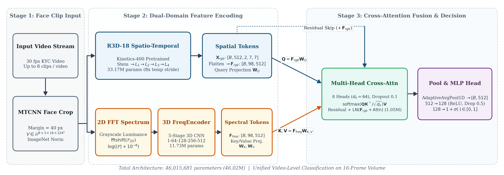
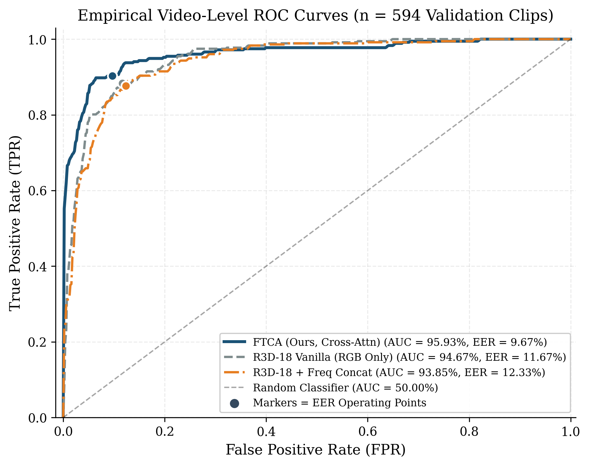
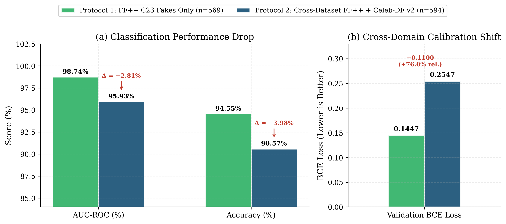
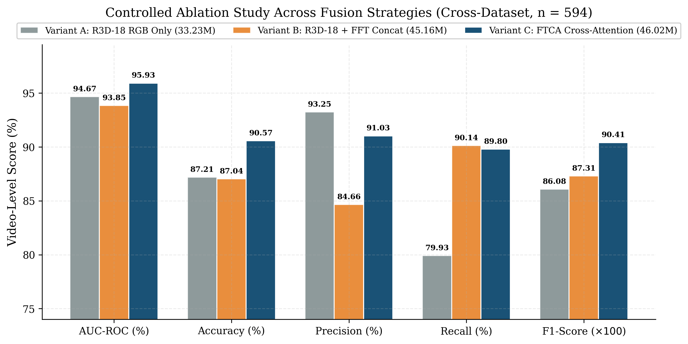
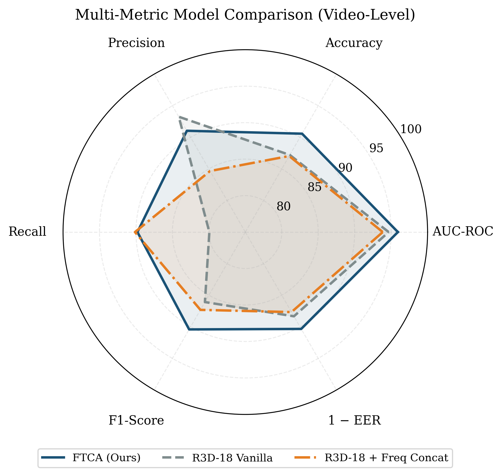
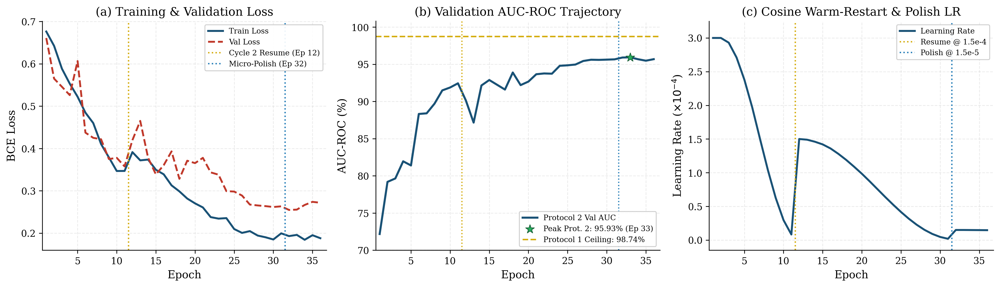
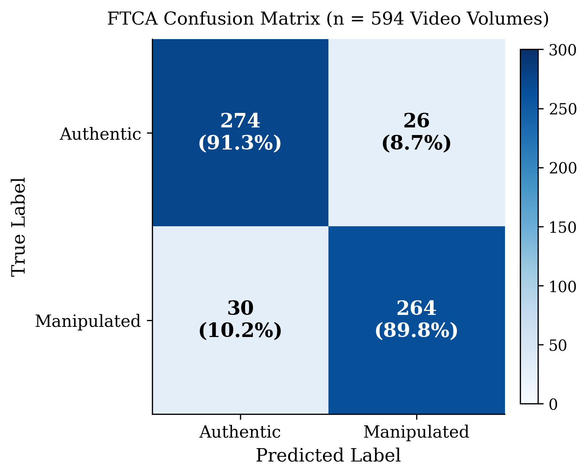

# AuthKYC: Frequency-Temporal Cross-Attention for Robust Video-Level Deepfake Detection in Remote Identity Verification

**Manmohan Vishwakarma**  
Department of Electronics and Communication Engineering  
National Institute of Technology Patna, Bihar, India  
`manmohanv.ug23.ec@nitp.ac.in`

---

## Abstract

Generative face manipulation poses an escalating threat to remote electronic Know-Your-Customer (e-KYC) identity verification in banking and financial services. While conventional 2D frame-level detectors achieve high accuracy on homogeneous benchmarks, they ignore inter-frame temporal coherence, struggle under heterogeneous video compression, and report inflated metrics over isolated static crops rather than video-level decisions. We propose **FTCA** (Frequency-Temporal Cross-Attention), the deep forensic engine within the multi-stage **AuthKYC** defense gateway. FTCA processes 16-frame facial video volumes through two parallel branches: a Kinetics-400 pretrained R3D-18 spatio-temporal encoder and a custom 3D FFT-based frequency encoder. Crucially, unlike naive feature concatenation—which we empirically demonstrate *degrades* performance—FTCA employs asymmetric multi-head cross-attention where spatial queries ($Q_{rgb}$) dynamically interrogate spectral keys and values ($K_{freq}, V_{freq}$) to isolate high-frequency manipulation artifacts.

We evaluate FTCA under two complementary protocols: (1) a **single-source manipulation protocol** on FaceForensics++ C23 fakes, where FTCA achieves **98.74% AUC-ROC** and **94.55% Accuracy**; and (2) a harder **cross-dataset protocol** introducing Celeb-DF v2 synthesis alongside FF++ C23 under mixed compression, where FTCA achieves **95.93% AUC-ROC**, **90.57% Accuracy**, and **9.67% EER** at the *video level*—outperforming all 3D spatio-temporal baselines. Adding only **0.85M parameters (+1.89%)** over naive concatenation, cross-attention delivers a **+2.08% AUC-ROC** and **+3.53% Accuracy** improvement while cutting EER from 12.33% to 9.67%.

---

## 1. Introduction

Remote digital onboarding and e-KYC verification underpin retail banking and fintech compliance under AML/CTF regulations. However, modern face-manipulation tools—including Deepfakes, Face2Face, FaceSwap, FaceShifter, and high-grade color-blended synthesis in Celeb-DF v2—enable realistic video injection attacks that challenge conventional spatial detectors.

Deploying 2D frame-level detectors (such as XceptionNet and EfficientNet-B4) in production KYC introduces three key failure modes:
1. **Temporal Blindness & Metric Inflation**: Evaluating static frames in isolation overlooks inter-frame flickering, mask boundaries, and lip-motion discontinuities, while evaluating ~32 correlated stills per video inflates apparent AUC relative to video-level operational verdicts.
2. **Spectral Vulnerability Under Compression**: Generative upsampling introduces periodic Fourier artifacts, which H.264 compression attenuates in pixel space.
3. **Cross-Dataset Fragility & Fusion Interference**: Models deteriorate across unseen synthesis pipelines and bitrates, and naive feature concatenation across RGB and frequency streams can trigger gradient interference rather than complementary fusion.

### Contributions
- **Dual-Domain Spatio-Temporal Encoding**: Parallel processing of 16-frame video volumes via Kinetics-400 pretrained R3D-18 (33.17M params) and a 5-stage 3D FFT `FrequencyEncoder` (11.73M params) with matched $8\times$ temporal stride.
- **Asymmetric Cross-Attention Fusion**: Token-level 8-head cross-attention where RGB tokens query spectral tokens ($Q_{rgb}, K_{freq}, V_{freq}$), adding just 0.85M parameters (+1.89%) over naive concatenation for +2.08% AUC gain.
- **Counter-Intuitive Ablation Evidence**: Demonstrating across identical 594-volume splits that naive FFT concatenation hurts AUC-ROC (93.85% vs. 94.67% RGB-only), whereas cross-attention reaches **95.93% AUC** and **9.67% EER**.
- **Cross-Dataset Gap Characterization**: Quantifying the 2.81% generalization gap between single-source FF++ C23 fakes (98.74% AUC) and mixed FF++ + Celeb-DF v2 (95.93% AUC).

---

## 2. Proposed Architecture

FTCA (`46,015,681` parameters total) operates in three stages:
1. **Face Tracking & Clip Extraction**: MTCNN crops faces with a 40-pixel margin and resizes crops into $[B, 3, 16, 224, 224]$ clips stored in $[0, 1]$ prior to training-time augmentation and ImageNet normalization.
2. **Spatio-Temporal RGB Branch (`R3D-18`, 33.17M params)**: Produces $\mathbf{X}_{rgb} \in \mathbb{R}^{B \times 512 \times 2 \times 7 \times 7}$, flattened to $\mathbf{F}_{rgb} \in \mathbb{R}^{B \times 98 \times 512}$.
3. **Dynamic 3D Frequency Branch (`FrequencyEncoder`, 11.73M params)**: Computes BT.601 luminance grayscale, centered orthonormal 2D FFT log-magnitude ($\epsilon = 10^{-8}$), and 5 stages of 3D convolution matching R3D-18 downsampling to yield $\mathbf{F}_{freq} \in \mathbb{R}^{B \times 98 \times 512}$.
4. **Asymmetric Multi-Head Cross-Attention & Head (1.12M params)**: 8-head cross-attention ($d_k = 64$, attention dropout 0.1) computes $\text{LayerNorm}(\mathbf{F}_{rgb} + \text{CrossAttn}(\mathbf{F}_{rgb}, \mathbf{F}_{freq}))$, followed by adaptive 1D average pooling and an MLP ($512 \rightarrow 128 \rightarrow 1$, ReLU, dropout $0.5$).

---

## 3. Experimental Setup & Protocols

All experiments ran on NVIDIA A40 GPU (48 GB VRAM) using PyTorch 2.4, AdamW ($\text{wd}=10^{-3}$), label smoothing ($\alpha=0.05$), gradient clipping ($\|g\|_2 \le 1.0$), and identical training-time augmentations (`HFlip`, `ColorJitter`, `GaussianBlur`, `RandomErasing`). Note that frame-level baselines (XceptionNet 96.90% frame AUC, EfficientNet-B4 94.63% frame AUC over 18,780 individual stills) operate under a non-comparable evaluation granularity and are excluded from the video-level primary benchmark table.

- **Protocol 1 (Single-Source Fakes — FF++ C23)**: 1,500 FF++ C23 fakes across 5 manipulation methods paired with 1,500 real videos (FF++ Original, Celeb-real, YouTube-real), yielding **2,091 train / 569 val** volumes (300 real, 269 fake).
- **Protocol 2 (Cross-Dataset Mixed Fakes — FF++ C23 + Celeb-DF v2)**: Adds Celeb-DF v2 `Celeb-synthesis` into the fake pool under heterogeneous compression, yielding **2,319 extracted train / 594 val** video volumes (300 real, 294 fake).

---

## 4. Results & Analysis

### 4.1 Single-Source Ceiling (Protocol 1)

| Metric | FTCA (Protocol 1 — FF++ C23 Fakes) |
| :--- | :---: |
| AUC-ROC | **98.74%** |
| Accuracy | **94.55%** |
| Validation BCE Loss | 0.1447 |
| Best Checkpoint Epoch | 11 / 50 (early-stopped @ 18) |

### 4.2 Controlled Video-Level Benchmark (Protocol 2, $n = 594$)

| Method | Architecture | Params | AUC-ROC (%) | Accuracy (%) | Precision (%) | Recall (%) | F1-Score | EER (%) |
| :--- | :--- | :---: | :---: | :---: | :---: | :---: | :---: | :---: |
| R3D-18 (RGB Only) | 3D ResNet-18 | 33.23M | 94.67 | 87.21 | **93.25** | 79.93 | 0.8608 | 11.67 |
| R3D-18 + Freq (Concat) | 3D ResNet-18 + FreqEnc | 45.16M | 93.85 | 87.04 | 84.66 | **90.14** | 0.8731 | 12.33 |
| **FTCA (Ours)** | **R3D-18 + FreqEnc + CrossAttn** | **46.02M** | **95.93** | **90.57** | 91.03 | 89.80 | **0.9041** | **9.67** |

### 4.3 Cross-Dataset Generalization Gap (2.81% AUC Drop)

Introducing Celeb-DF v2 synthesis causes AUC-ROC to shift from **98.74%** to **95.93%** ($-2.81\%$) and validation BCE loss to increase from **0.1447** to **0.2547**, driven by:
1. Heterogeneous YouTube compression altering Fourier quantization roll-off compared to uniform FF++ C23.
2. Improved color transfer and facial mask blending in Celeb-DF v2 suppressing naive boundary artifacts.
3. Capture heterogeneity across studio vs. celebrity video domains.

---

## 5. Ablation Study & Training Dynamics

- **Why Naive Concatenation Fails (Variant B)**: Global pooling discards spatio-temporal correspondence before fusion, and heavy-tailed log-FFT activations destabilize linear fusion, dropping precision from 93.25% to 84.66% and AUC from 94.67% to 93.85%.
- **Why Cross-Attention Succeeds (Variant C)**: Keeping all $L=98$ tokens unpooled lets spatial queries selectively gate spectral anomalies via residual $\text{LayerNorm}(\mathbf{F}_{rgb} + \text{CrossAttn})$, adding only **0.85M params (+1.89%)** for **+2.08% AUC** and **+3.53% Accuracy**.

Across 36 epochs of Protocol 2 training: Cycle 1 (Epochs 1–11) rises to 92.44% AUC; Cycle 2 Resumption at `1.5e-4` (Epochs 12–31) dips briefly to 87.16% at Epoch 13 before reaching 95.66% at Epoch 31 (`lr = 1.92e-6`); and Micro-Polishing at `1.5e-5` (Epochs 32–36) reaches lowest loss (**0.2547**, Ep 32) and peak **95.93% AUC-ROC** (Ep 33).

---

## 6. Deployment & Conclusion

Across the 594 mixed-domain validation clips, FTCA correctly authenticates **274/300 genuine videos (91.3% specificity)** and catches **264/294 deepfake attacks (89.8% recall)**, cutting missed deepfakes nearly in half vs. vanilla R3D-18 (30 vs. 59). Within the **AuthKYC** 4-stage waterfall PAD gateway (PRNU -> Moiré 2D-FFT -> CHROM rPPG -> FTCA), full A40 validation evaluation over 569 clips completes in 79.00 s (**138.8 ms** amortized per 16-frame window including tensor I/O), demonstrating practical real-time viability behind lightweight CPU screening gates.
